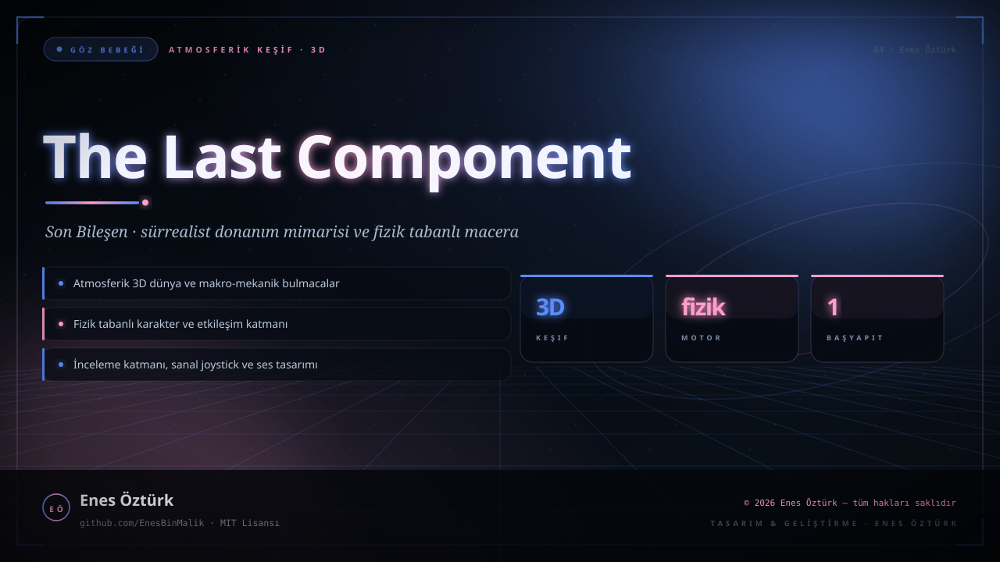
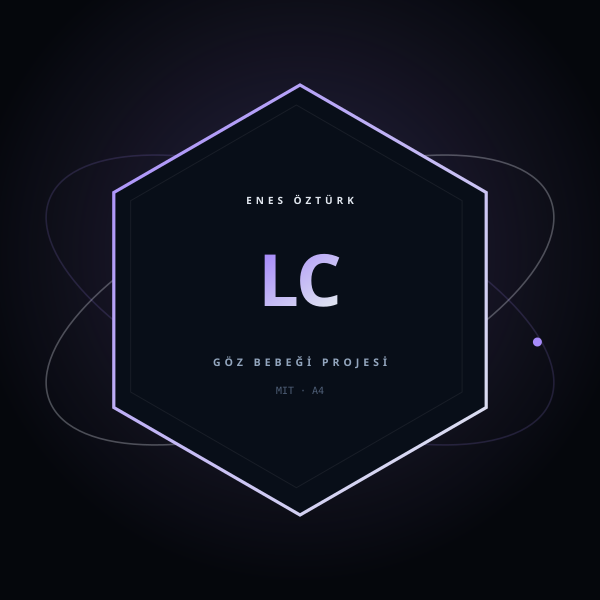

# The Last Component (Son Bileşen)



<p align="center"></p>

<p align="center"><b>GÖZ BEBEĞİ PROJESİ</b> · ATMOSFERİK KEŞİF · 3D · MACERA</p>

---

Sürrealist donanım mimarisinde atmosferik keşif: fizik tabanlı makro-mekanik bulmacalar ve derin bir hikâye.

## Öne çıkanlar

- **Oyun motoru** — `src/game/GameEngine.ts` ile sahne ve döngü
- **Dünya** — `world.ts` ve `textures.ts` ile prosedürel atmosfer
- **Fizik tabanlı karakter** — `character.ts` ile yumuşak hareket
- **Bulmacalar** — `puzzles.ts` ile makro-mekanik düzenekler
- **İnceleme katmanı** — `InspectionOverlay` ile nesne inceleme
- **Dokunmatik kontrol** — `VirtualJoystick` ve ses tasarımı

## Teknoloji

React · TypeScript · Three.js · Vite · Motion · Tailwind CSS

## Kurulum ve çalıştırma

```bash
npm install
npm run dev        # http://localhost:3000
```

| Komut | Ne yapar |
| --- | --- |
| `npm install` | bağımlılıkları kurar |
| `npm run dev` | geliştirme sunucusunu açar |
| `npm run build` | üretim derlemesi üretir |
| `npm run lint` | tip denetimi (`tsc --noEmit`) |

## Proje yapısı

```
the-last-component-(son-bileşen)/
├── index.html
├── package.json
├── vite.config.ts
├── docs/
│   ├── kapak.svg        # sinematik kapak
│   └── rozet.svg        # premium imza rozeti
└── src/
```

## Lisans ve telif

Bu proje **MIT Lisansı** ile yayınlanmıştır.

> © 2026 **Enes Öztürk** — tüm hakları saklıdır.
> Tasarım, kod ve görseller Enes Öztürk'e aittir. İzinsiz ticari kullanım yapılamaz.

[MIT Lisansı metni →](LICENSE)

---

<div align="center"><sub>
<a href="https://github.com/EnesBinMalik">github.com/EnesBinMalik</a> · 
imzalı bir <b>Enes Öztürk</b> projesi
</sub></div>
